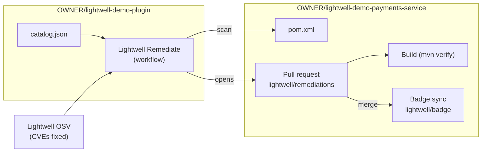

# Architecture

How the pieces in the three demos fit together. All three use the public Lightwell demo feeds.

## Artifactory and Xray (Demo 2)

```mermaid
flowchart LR
    subgraph Dev["Developer (no app code changes)"]
        APP["payments-service<br/>pom.xml: woodstox.version<br/>6.0.3 to 6.0.3.rhlw-00001"]
        SETTINGS["settings.xml<br/>mirror: acmebank_java_repo"]
    end

    subgraph ART["JFrog Artifactory"]
        ACME["acmebank_java_repo<br/>(company virtual)"]
        subgraph LW["lightwell-java (virtual)"]
            REM["1. lightwell-java-remediated<br/>(remote)"]
            VAL["2. lightwell-java-validated<br/>(remote)"]
        end
        MC["maven-central<br/>(remote)"]
    end

    subgraph XR["JFrog Xray"]
        CI["Custom Issues<br/>(Lightwell OSV)"]
        W["Watch + policy<br/>lightwell-demo-watch"]
        IR["Ignore rule<br/>XRAY-255585 on 6.0.3.rhlw-00001"]
    end

    subgraph RH["Red Hat Lightwell (packages.redhat.com)"]
        RHREM["java/remediated/"]
        RHVAL["java/validated/"]
        OSV["OSV advisories"]
    end

    CENTRAL["Maven Central"]

    APP --> SETTINGS --> ACME
    ACME -->|"first"| LW
    ACME -->|"then"| MC
    REM --> RHREM
    VAL --> RHVAL
    MC --> CENTRAL
    OSV -->|"lightwell-xray-sync"| CI
    W -. "scans" .-> REM
    W -. "scans" .-> VAL
```

1. **Remotes per Lightwell tier:** `lightwell-java-remediated` and `lightwell-java-validated`. On production feeds, the Lightwell service account is set once on each remote. Predisclosure (production only) would be a third remote, first in order.
2. **`lightwell-java` virtual:** remediated first, then validated.
3. **Company virtual `acmebank_java_repo`:** `lightwell-java` first, then `maven-central`, so ordinary dependencies still resolve.
4. **Developers** keep one Maven mirror pointing at the company repository. To adopt a fix, they change one version in `pom.xml`.
5. **Xray** gets Red Hat's Lightwell OSV advisories as Custom Issues (`tools/lightwell-xray-sync`), so it shows the Lightwell fix version next to the upstream one. An ignore rule records that JFrog's version-based finding doesn't apply to the Lightwell build.

## GitHub plugin (Demo 3)

1. The plugin's workflow checks out the app, scans its poms against the catalog, and looks up the CVEs each Lightwell build fixes.
2. It pushes the version bumps to `lightwell/remediations` and opens a pull request with the CVE and CVSS table.
3. The app's CI builds and tests the Lightwell versions on the PR.
4. After merge, the app's badge sync rescans and updates the README badge.

## Provenance (Demo 1)

Every Lightwell build is published with a CycloneDX SBOM, a Sigstore bundle with signed SLSA provenance, and a GPG signature. `demos/01-lightwell-walkthrough/verify-provenance.sh` downloads them and uses `cosign verify-blob-attestation` with Red Hat's provenance public key to check that the JAR's digest matches the signed statement.
